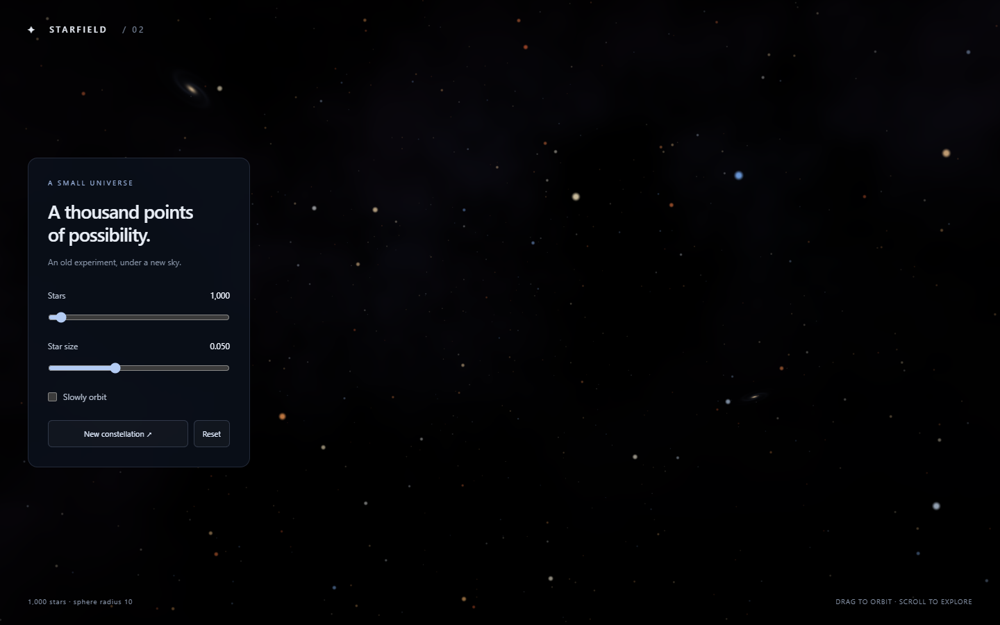

# Starfield

Static, dependency-free WebGL reimplementation of an old Starfield demo I made in Unity.
Open index.html directly in a WebGL-capable browser. No server, installation,
build step, or network access is required. Any static host works too.

Original defaults: 1,000 stars uniformly distributed inside a sphere of
radius 10, star diameter 0.05, black background, and a 60-degree vertical field
of view. The camera starts at (0, 1, -10), facing the sphere center (the original
Unity camera faced straight forward).

Drag the background to orbit; scroll to zoom. Sliders adjust count and size.
Slowly orbit enables animation; New constellation randomizes the stars.
Reset restores the defaults and generates a fresh field. When stationary,
frames render only after interaction or resizing. Resolution is capped at 2x.

Native WebGL point sprites, soft circular edges, additive blending, plain JS.

Stars have randomized warm orange, gold, ivory, white and blue colors.
Brightness follows softened inverse-square falloff with camera distance:
1 / (1 + 0.035 * distance squared). Orbiting and zooming update it live.

A faint procedural blue/violet nebula is rendered behind the stars. Its
cloud layers follow camera orientation and require no textures or downloads.

Four subtle procedural spiral galaxies sit on the distant sky, with warm
cores and cool inclined disks. They follow camera orientation along with the
nebula. All background effects are generated in WebGL without image assets.

Licensed under the [MIT License](LICENSE).
